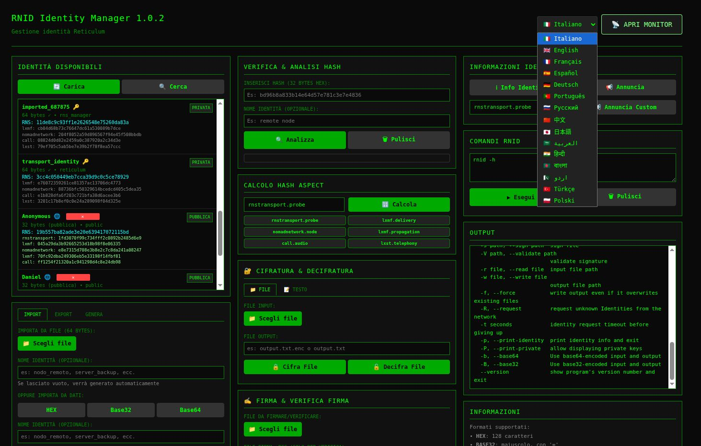
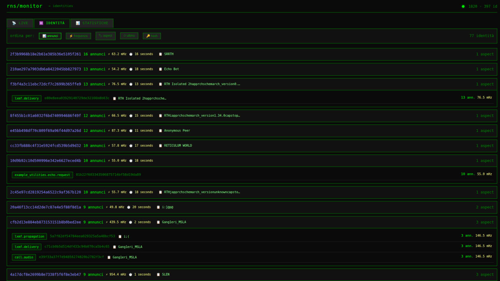
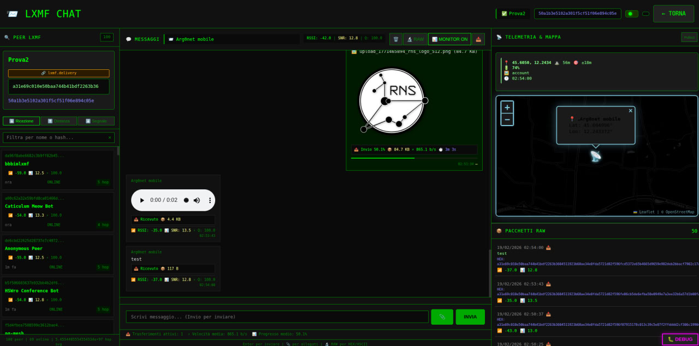
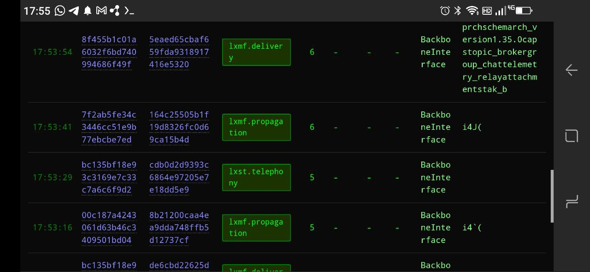

# RNS-Manager

**English** | [Русский](README.ru.md)

Monorepo with two independent Reticulum (RNS) applications:

| Project | Description | Port |
|---|---|---|
| [**manager/**](manager/) | Identity Manager + Aspect Monitor: RNS identity management, encryption/signing, real-time announce monitoring with SQLite cache | `5010` |
| [**messenger/**](messenger/) | RNS Messenger: LXMF chat with attachments, Codec2/Opus audio, telemetry, map and remote commands | `5012` |

The two applications have **separate code, dependencies, builds and documentation** and share only the `~/.rns_manager/` data directory (identities, `config.json`, uploads, announce cache).

## 📁 Repository structure

```ini
RNS-Manager/
├── manager/          # Flask Identity Manager + Aspect Monitor
│   ├── rns_manager.py
│   ├── modules/rns_monitor.py
│   ├── templates/ static/ img/
│   ├── requirements.txt
│   └── README.md / README.ru.md
├── messenger/        # Flask-SocketIO LXMF Messenger
│   ├── lxmf_chat.py
│   ├── messenger.py
│   ├── core/
│   ├── templates/ static/ img/
│   ├── requirements.txt
│   └── README.md / README.ru.md
├── legacy/           # unused historical material (not included in builds)
├── tests/            # unit tests (unittest)
├── tools/            # helper scripts (inline JS validation)
├── sideband_plugins/ # Sideband rangetest command plugin
├── lxst-telephony/   # importable LXST peer-to-peer telephony endpoint
├── .github/          # CI workflow
├── LICENSE
└── .gitignore
```

## 🚀 Quick start

### Manager (Identity Manager + Monitor)

```bash
cd manager
pip install -r requirements.txt
python3 rns_manager.py     # or ./start.sh
```

Open <http://127.0.0.1:5010/>.

### RNS Messenger

```bash
cd messenger
pip install -r requirements.txt
python3 lxmf_chat.py -p 5012     # or ./start.sh
```

Open <http://127.0.0.1:5012/>.

## 🧪 Tests

```bash
python -m unittest discover -s tests -v
python tools/check_inline_js.py
```

CI: `.github/workflows/ci.yml` (Python compile, inline JS validation, unit tests).

## 📸 Screenshots

| Identity Manager | Aspect Monitor |
|---|---|
|  |  |

| LXMF Messenger | Monitor mobile |
|---|---|
|  |  |

## 🔒 Data and privacy

The repository **does not contain** personal or runtime data: caches, SQLite databases, downloads, uploads, sockets, identities and secrets are excluded by `.gitignore`.

Application data stays in the user's home directory:

```ini
~/.rns_manager/storage/          # RNS identities and peers databases
~/.rns_manager/config.json       # messenger configuration
~/.rns_manager/uploads/          # uploaded attachments
~/.rns_manager/cache/announces.db  # announce cache shared by Manager and Messenger
```

## 🧰 Common requirements

- Python 3.8+ (manager) / 3.9+ (messenger)
- Reticulum installed (`pip install rns`)
- `rnid`, `rnstatus`, `rnpath`, `rnprobe` available in `PATH` for the manager

## 📝 License

Distributed under the MIT License. See [LICENSE](LICENSE).

Third-party notice: the optional `lxst_telephony` package and the Messenger
voice functionality use **LXST**, distributed under **CC BY-NC-ND 4.0**.
LXST is free for non-commercial use; commercial use requires a separate
license from its author. See [`lxst-telephony/THIRD_PARTY_LICENSES/LXST.txt`](lxst-telephony/THIRD_PARTY_LICENSES/LXST.txt).

## 📧 Contact

- Email: <arg0netds@gmail.com>
- GitHub: <https://github.com/argo79/RNS-Manager>
- RNS Identity: `04511923b68ae34e0fda5721d82f596f`

---

Documentation: [Manager (EN)](manager/README.md) · [Manager (RU)](manager/README.ru.md) · [Messenger (EN)](messenger/README.md) · [Messenger (RU)](messenger/README.ru.md)
