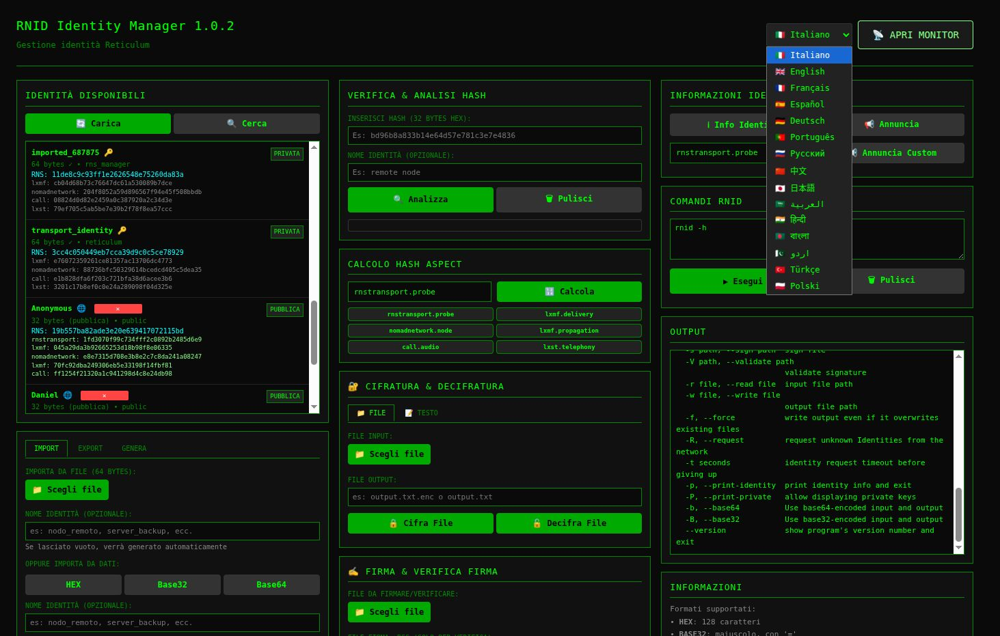
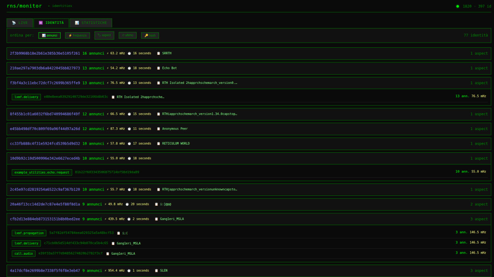
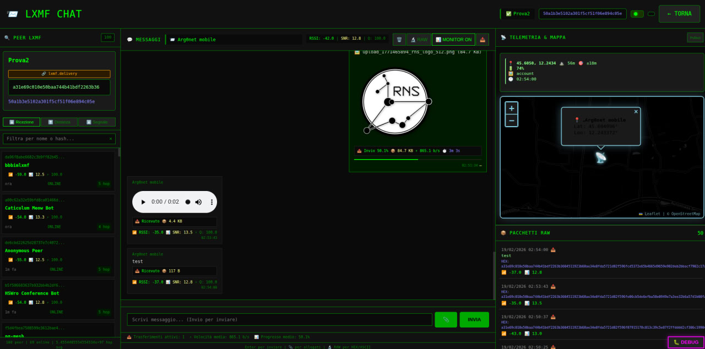
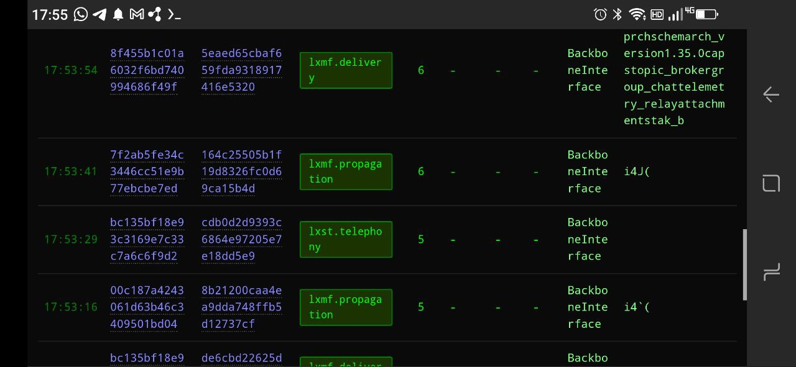

# RNS-Manager

[English](README.md) | **Русский**

Монорепозиторий с двумя независимыми приложениями Reticulum (RNS):

| Проект | Описание | Порт |
|---|---|---|
| [**manager/**](manager/) | Менеджер идентичностей + монитор аспектов: управление идентичностями RNS, шифрование/подпись, мониторинг анонсов в реальном времени с кэшем SQLite | `5010` |
| [**messenger/**](messenger/) | RNS Messenger: чат LXMF с вложениями, аудио Codec2/Opus, телеметрией, картой и удалёнными командами | `5012` |

У приложений **отдельный код, зависимости, сборка и документация**; они совместно используют только каталог данных `~/.rns_manager/` (идентичности, `config.json`, загрузки, кэш анонсов).

## 📁 Структура репозитория

```ini
RNS-Manager/
├── manager/          # Flask Identity Manager + Aspect Monitor
│   ├── rns_manager.py
│   ├── modules/rns_monitor.py
│   ├── templates/ static/ img/
│   ├── requirements.txt
│   └── README.md / README.ru.md
├── messenger/        # Flask-SocketIO LXMF Messenger
│   ├── lxmf_chat.py
│   ├── messenger.py
│   ├── core/
│   ├── templates/ static/ img/
│   ├── requirements.txt
│   └── README.md / README.ru.md
├── legacy/           # неиспользуемые исторические файлы (не входят в сборки)
├── tests/            # модульные тесты (unittest)
├── tools/            # вспомогательные скрипты (проверка inline JS)
├── sideband_plugins/ # command plugin rangetest для Sideband
├── lxst-telephony/   # импортируемый LXST endpoint для P2P-звонков
├── .github/          # конфигурация CI
├── LICENSE
└── .gitignore
```

## 🚀 Быстрый старт

### Менеджер (Identity Manager + Monitor)

```bash
cd manager
pip install -r requirements.txt
python3 rns_manager.py     # или ./start.sh
```

Откройте <http://127.0.0.1:5010/>.

### RNS Messenger

```bash
cd messenger
pip install -r requirements.txt
python3 lxmf_chat.py -p 5012     # или ./start.sh
```

Откройте <http://127.0.0.1:5012/>.

## 🧪 Тесты

```bash
python -m unittest discover -s tests -v
python tools/check_inline_js.py
```

CI: `.github/workflows/ci.yml` (компиляция Python, проверка inline JS, модульные тесты).

## 📸 Скриншоты

| Identity Manager | Монитор аспектов |
|---|---|
|  |  |

| LXMF Messenger | Монитор на мобильном |
|---|---|
|  |  |

## 🔒 Данные и конфиденциальность

Репозиторий **не содержит** личных данных или данных времени выполнения: кэш, базы данных SQLite, загрузки, сокеты, идентичности и секреты исключены через `.gitignore`.

Данные приложений остаются в домашнем каталоге пользователя:

```ini
~/.rns_manager/storage/            # идентичности RNS и базы пиров
~/.rns_manager/config.json        # конфигурация messenger
~/.rns_manager/uploads/           # загруженные вложения
~/.rns_manager/cache/announces.db # кэш анонсов, общий для Manager и Messenger
```

## 🧰 Общие требования

- Python 3.8+ (manager) / 3.9+ (messenger)
- Установленный Reticulum (`pip install rns`)
- Команды `rnid`, `rnstatus`, `rnpath`, `rnprobe` в `PATH` для менеджера

## 📝 Лицензия

Распространяется по лицензии MIT. См. [LICENSE](LICENSE).

Уведомление о сторонних компонентах: опциональный пакет `lxst_telephony` и
голосовые функции Messenger используют **LXST** под лицензией
**CC BY-NC-ND 4.0**. LXST бесплатен для некоммерческого использования;
для коммерческого использования требуется отдельная лицензия автора.
См. [`lxst-telephony/THIRD_PARTY_LICENSES/LXST.txt`](lxst-telephony/THIRD_PARTY_LICENSES/LXST.txt).

## 📧 Контакты

- Email: <arg0netds@gmail.com>
- GitHub: <https://github.com/argo79/RNS-Manager>
- RNS Identity: `04511923b68ae34e0fda5721d82f596f`

---

Документация: [Manager (EN)](manager/README.md) · [Manager (RU)](manager/README.ru.md) · [Messenger (EN)](messenger/README.md) · [Messenger (RU)](messenger/README.ru.md)
