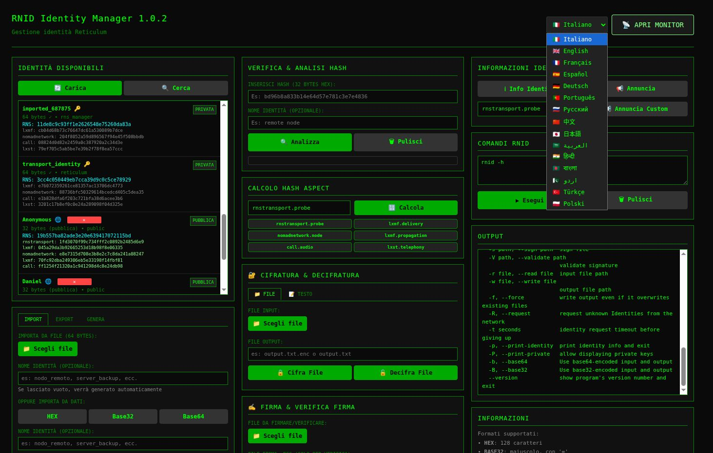
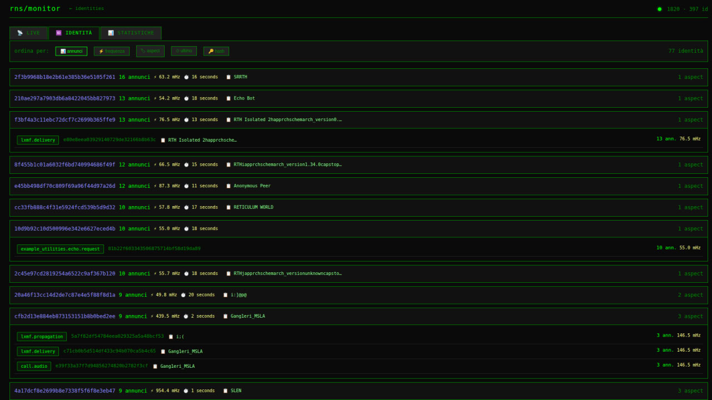
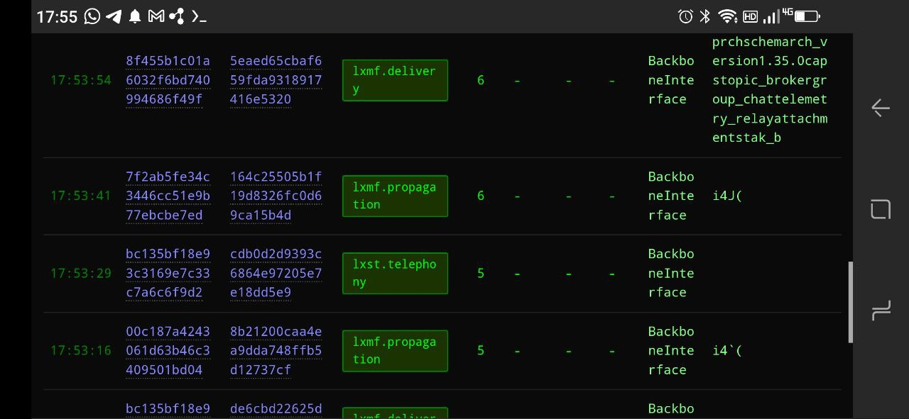
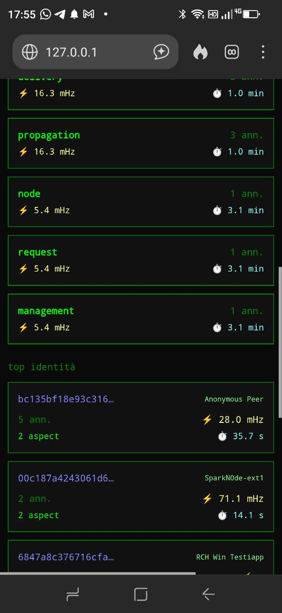
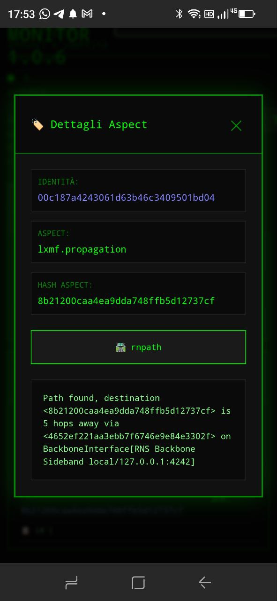
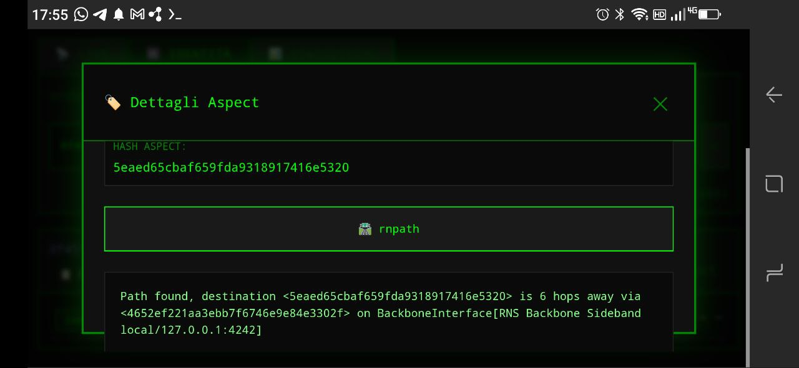

# 🔑 RNS Manager & Monitor 🌐

Interfaccia web per la gestione delle identità Reticulum (RNS) e il monitoraggio in tempo reale degli annunci di rete.

Questo è il progetto **Manager**: il messenger LXMF è un progetto separato nella cartella [`../messenger/`](../messenger/).

## 📋 Panoramica



Funzionalità principali:

- **Gestione identità RNS**: creazione, import, export, visualizzazione, cifratura/firma
- **Monitor annunci RNS** in tempo reale con filtri, statistiche e cache persistente
- **Comandi RNS** (`rnstatus`, `rnpath`, `rnprobe`) da interfaccia grafica
- **Cifratura/decifratura** di file e testo con identità RNS
- **Firma e verifica** digitale (`.rsg`)

## ✨ Caratteristiche

### Identity Manager
- ✅ Visualizzazione identità da `reticulum`, `nomadnetwork`, `lxmf`, `rnphone`, `meshchat`, `rns_manager`
- ✅ Import/export in HEX, Base32, Base64 e file binario
- ✅ Generazione nuove identità
- ✅ Analisi hash, calcolo hash aspect, verifica destinazioni
- ✅ Cifratura/decifratura file e testo
- ✅ Firma digitale e verifica firme

### Aspect Monitor
- 📡 Annunci in tempo reale via **SSE** (`/api/monitor/stream`)
- 🔍 Filtri per aspect, ricerca testuale, ordinamento
- 📊 Statistiche per identità/aspect/interfaccia e dati radio (RSSI, SNR, Q)
- 🏷️ Riconoscimento automatico dell'aspect con cache per identità
- 💾 Cache SQLite persistente (`cache/announces.db`, 7 giorni, max 100.000 record)
- 🖱️ Modali interattive per `rnpath`, `rnprobe` e controllo blackhole


## 📸 Screenshot

| Desktop | Mobile |
|---|---|
|  |  |
|  |  |
|  |  |

Altre immagini: `img/rnid-es.jpg` (spagnolo), `img/rnid-ar.jpg` e `img/arab-RNID.jpg` (arabo), `img/rnid-ru.jpg` (russo), `img/monitor-mobile-header.jpg`, `img/monitor-mobile-identity-filter.jpg`, `img/monitor-ID.jpg`, `img/aspect.jpg`.

## 🚀 Installazione

### Prerequisiti
- Python 3.8+
- Reticulum installato e configurato
- Comandi `rnid`, `rnstatus`, `rnpath`, `rnprobe` nel `PATH`

### Avvio

```bash
git clone https://github.com/argo79/RNS-Manager.git
cd RNS-Manager/manager

pip install -r requirements.txt
python3 rns_manager.py
```

Oppure:

```bash
./start.sh
```

Poi aprire:

- Identity Manager: <http://127.0.0.1:5010/>
- Aspect Monitor: <http://127.0.0.1:5010/api/monitor> (redirect da `/monitor`)

L'app apre automaticamente il browser all'avvio.

## 📁 Struttura

```ini
manager/
├── rns_manager.py            # Server Flask principale
├── version.py                # Versione del progetto
├── requirements.txt
├── modules/
│   └── rns_monitor.py        # Monitor annunci (processo + SQLite + blueprint)
├── templates/
│   ├── index.html            # Identity Manager
│   └── monitor.html          # Aspect Monitor
├── static/                   # CSS, favicon, traduzioni
├── tools/
│   ├── check_aspect.py       # Diagnostica aspect via rnid
│   ├── check_aspect2.py      # Brute-force namespace/aspect
│   └── rns_announce.py       # Esempio di invio announce
├── img/                      # Screenshot
├── rns_manager.spec          # Spec PyInstaller
└── build_rns_manager.sh      # Build eseguibile standalone
```

Cartelle create a runtime dentro `manager/`: `cache/`, `downloads/`, `tmp/` e il socket `rns_monitor.sock`.

## 🗂️ Directory delle identità

Il programma cerca identità in:

```ini
~/.reticulum/storage/
~/.nomadnetwork/storage/
~/.lxmf/storage/
~/.rnphone/
~/.reticulum-meshchat/
~/.rns_manager/storage/
```

La cartella `~/.rns_manager/storage/` è **condivisa con il Messenger**: le identità importate qui sono disponibili anche nell'altra applicazione.

## 🎮 Utilizzo

**Identity Manager**: premi *Carica* per elencare le identità, seleziona un'identità e usa *Info*, *Annuncia*, *Import/Export*, *Genera*, *Cifra/Decifra*, *Firma/Verifica*.

**Aspect Monitor**: usa le tab *Live*, *Identità*, *Statistiche*; clicca sugli hash per aprire i comandi `rnpath`, `rnprobe`, `rnpath -p`.

## 🔧 Configurazione

- **Cache identità**: 5 minuti (in memoria); *Ricerca profonda* forza la scansione.
- **Cache annunci**: SQLite in `cache/announces.db`, retention 7 giorni.
- **Aspect riconosciuti**: lista `RNS_ASPECTS` in `modules/rns_monitor.py` **e** array `ASPECTS` in `templates/monitor.html`: vanno mantenuti allineati.
- **Directory di ricerca**: `USER_DIRECTORIES` in `rns_manager.py`.

## 📊 API principali

### Identità
```ini
GET  /api/identities/list          POST /api/identities/import/file
POST /api/identities/import/data   POST /api/identities/export
POST /api/identities/generate      POST /api/identities/info
POST /api/identities/encrypt       POST /api/identities/decrypt
POST /api/identities/sign          POST /api/identities/verify
GET  /api/identities/find/by-hash  POST /api/rnid
GET  /api/cache/identities/status  POST /api/cache/identities/clear
POST /api/cache/identities/refresh POST /api/upload/temp
POST /api/cleanup/temp
```

### Monitor
```ini
GET  /api/monitor                  GET  /api/monitor/stats
GET  /api/monitor/history          GET  /api/monitor/stream
GET  /api/monitor/peer/<hash>      POST /api/monitor/clear
POST /api/monitor/reset-all        POST /api/monitor/announce
GET  /api/monitor/sqlite/stats     GET  /api/monitor/sqlite/search
GET  /api/monitor/sqlite/peer/<hash>/stats
POST /api/monitor/sqlite/cleanup   POST /api/monitor/sqlite/vacuum
```

### Comandi RNS
```ini
GET  /api/rns/status               GET  /api/rns/paths
POST /api/rns/probe                POST /api/rns/probe/aspect
POST /api/rns/paths/blackhole
```

### Sistema
```ini
POST /api/shutdown
POST /api/files/relocate     # sposta/copia un file da tmp a downloads (sicuro, senza shell)
```

## 📦 Build eseguibile

```bash
cd manager
./build_rns_manager.sh
# output: dist/rns_manager_v<versione>.run
```

## 📱 Android via Termux

```bash
git clone https://github.com/argo79/RNS-Manager.git
cd RNS-Manager/manager
pip install -r requirements.txt --break-system-packages
python3 rns_manager.py
```

Aprire il browser su `http://127.0.0.1:5010`.

## 🔗 Progetti correlati

- **RNS Messenger** ([`../messenger/`](../messenger/)): chat LXMF completa con allegati, audio, telemetria e mappa. Si avvia separatamente sulla porta **5012**.

## 🐛 Problemi noti

- La prima scansione delle identità può richiedere 10–30 secondi.
- Alcuni aspect potrebbero non essere riconosciuti.
- Su mobile alcune tabelle richiedono scorrimento orizzontale.

## 📝 Licenza

Distribuito sotto licenza MIT. Vedi [`../LICENSE`](../LICENSE).

## ☕ Supporta lo sviluppo

| Crypto | Indirizzo |
|---|---|
| **XRP** | `rBKbetm51vuQQfg4Yo8fvweRya7gedcr9J` |
| **XMR** | `87jacZEtYvXcgnvEp7wu45gLwRBYpvwMr3N9dqhNipPWV69XwQX658tS73VEdghLopG1wA4STEdMPcGF8Tc3e18eJyQ4kMA` |
| **ETH** | `0xd2d85288df96B4162814Ca7492039620371b9D81` |

## 📧 Contatto

- Email: <arg0netds@gmail.com>
- GitHub: <https://github.com/argo79/RNS-Manager>
- RNS Identity: `04511923b68ae34e0fda5721d82f596f`

English version: [README.en.md](README.en.md)


