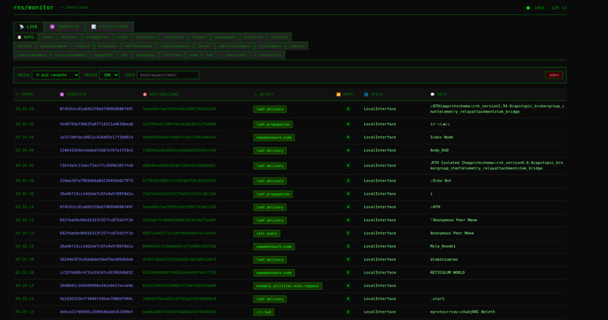
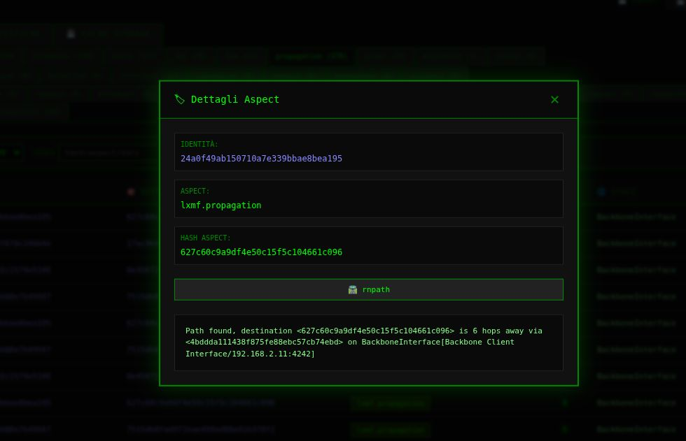

# 🔑 RNS Manager & Monitor 🌐

**English** | [Русский](README.ru.md)

Web interface for managing Reticulum (RNS) identities and monitoring network announces in real time.

This is the **Manager** project. The LXMF messenger is a separate project in [`../messenger/`](../messenger/).

## 📋 Overview


Main features:

- **RNS identity management**: create, import, export, view, encrypt/sign
- **Real-time announce monitor** with filters, statistics and persistent cache
- **RNS commands** (`rnstatus`, `rnpath`, `rnprobe`) from a graphical interface
- **File and text encryption/decryption** with RNS identities
- **Digital signing and verification** (`.rsg`)
- **Interface available in 15 languages** (it, en, fr, es, de, pt, ru, zh, ja, ar, hi, bn, ur, tr, pl)

## ✨ Features

### Identity Manager
- ✅ Identities from `reticulum`, `nomadnetwork`, `lxmf`, `rnphone`, `meshchat`, `rns_manager`
- ✅ Import/export as HEX, Base32, Base64 and binary file
- ✅ New identity generation
- ✅ Hash analysis, aspect hash calculation, destination verification
- ✅ File and text encryption/decryption
- ✅ Digital signing and signature verification

### Aspect Monitor
- 📡 Real-time announces over **SSE** (`/api/monitor/stream`)
- 🔍 Aspect filters, text search, sorting
- 📊 Statistics per identity/aspect/interface plus radio data (RSSI, SNR, Q)
- 🏷️ Automatic aspect recognition with per-identity cache
- 💾 Persistent SQLite cache (`~/.rns_manager/cache/announces.db`, shared with the Messenger, 7 days, max 100,000 rows)
- 🖱️ Interactive modals for `rnpath`, `rnprobe` and blackhole checks



## 📸 Screenshots

| Desktop | Mobile |
|---|---|
|  |  |
|  |  |
|  |  |

More images: `img/rnid-es.jpg` (Spanish UI), `img/rnid-ar.jpg` and `img/arab-RNID.jpg` (Arabic), `img/rnid-ru.jpg` (Russian), `img/monitor-mobile-header.jpg`, `img/monitor-mobile-identity-filter.jpg`, `img/monitor-ID.jpg`, `img/aspect.jpg`.

## 🚀 Installation

### Requirements
- Python 3.8+
- Reticulum installed and configured
- `rnid`, `rnstatus`, `rnpath`, `rnprobe` available in `PATH`

### Run

```bash
git clone https://github.com/argo79/RNS-Manager.git
cd RNS-Manager/manager

pip install -r requirements.txt
python3 rns_manager.py
```

Or:

```bash
./start.sh
```

Then open:

- Identity Manager: <http://127.0.0.1:5010/>
- Aspect Monitor: <http://127.0.0.1:5010/api/monitor> (`/monitor` redirects here)

The browser is opened automatically at startup.

## 📁 Project structure

```ini
manager/
├── rns_manager.py            # Main Flask server
├── version.py
├── requirements.txt
├── modules/
│   └── rns_monitor.py        # Announce monitor (process + SQLite + blueprint)
├── templates/
│   ├── index.html            # Identity Manager
│   └── monitor.html          # Aspect Monitor
├── static/                   # CSS, favicon, translations
├── tools/                    # Aspect diagnostics and announce example
├── img/                      # Screenshots
├── rns_manager.spec          # PyInstaller spec
└── build_rns_manager.sh      # Standalone build
```

Runtime folders created inside `manager/`: `downloads/`, `tmp/` and `rns_monitor.sock`. The announce cache is stored in `~/.rns_manager/cache/` (shared with the Messenger).

## 🗂️ Identity directories

Identities are searched in:

```ini
~/.reticulum/storage/
~/.nomadnetwork/storage/
~/.lxmf/storage/
~/.rnphone/
~/.reticulum-meshchat/
~/.rns_manager/storage/
```

`~/.rns_manager/storage/` is **shared with the Messenger**: identities imported here are available to both applications.

## 🎮 Usage

**Identity Manager**: press *Load* to list identities, select one and use *Info*, *Announce*, *Import/Export*, *Generate*, *Encrypt/Decrypt*, *Sign/Verify*.

**Aspect Monitor**: use the *Live*, *Identities* and *Statistics* tabs; click hashes to open `rnpath`, `rnprobe`, `rnpath -p`.

## 🔐 Security

- The server binds to `127.0.0.1` and rejects requests with non-local `Host` headers and
  cross-origin `Origin`/`Referer` on state-changing methods (DNS-rebinding/CSRF hardening).
- Security headers (`CSP`, `X-Frame-Options`, `X-Content-Type-Options`) are enabled.
- Identity file operations are restricted to the known identity directories; `/api/rnid`
  accepts only an allowlist of options.
- Uploads are limited to 16 MB.
- Optional token auth: set `RNS_AUTH_TOKEN` and open the UI with `?token=...` (cookie/header supported).
- `RNS_MANAGER_SKIP_MONITOR=1` disables the monitor process/listener (WSGI multi-worker/tests); useful when the monitor runs separately.
- `RNS_MANAGER_CACHE_DIR` overrides the cache directory.

## 🔧 Configuration

- **Identity cache**: 5 minutes by default (in memory, `RNS_IDENTITY_CACHE_TTL` to override); the UI refresh forces a full scan.
- **Announce cache**: SQLite in `~/.rns_manager/cache/announces.db`, 7-day retention (shared with the Messenger).
- **Recognised aspects**: `RNS_ASPECTS` in `modules/rns_monitor.py` **and** the `ASPECTS` array in `templates/monitor.html` must be kept in sync.
- **Search directories**: `USER_DIRECTORIES` in `rns_manager.py`.
- **UI translations**: `static/index_translations.json` (15 languages); the default language follows the browser, and the selector is in the header.

## 📊 Main APIs

```ini
GET  /api/identities/list          POST /api/identities/import/file
POST /api/identities/import/data   POST /api/identities/export
POST /api/identities/generate      POST /api/identities/info
POST /api/identities/encrypt       POST /api/identities/decrypt
POST /api/identities/sign          POST /api/identities/verify
GET  /api/identities/find/by-hash  POST /api/rnid
GET  /api/monitor                  GET  /api/monitor/stats
GET  /api/monitor/history          GET  /api/monitor/stream
GET  /api/monitor/sqlite/stats     GET  /api/monitor/sqlite/search
POST /api/monitor/clear            POST /api/monitor/reset-all
POST /api/monitor/sqlite/cleanup   POST /api/monitor/sqlite/vacuum
GET  /api/rns/status               GET  /api/rns/paths
POST /api/rns/probe                POST /api/rns/probe/aspect
POST /api/rns/paths/blackhole      POST /api/shutdown
POST /api/files/relocate           # move/copy tmp -> downloads (safe, no shell)
```

## 📦 Standalone build

```bash
cd RNS-Manager
python3.11 -m venv .venv
source .venv/bin/activate
python -m pip install -r manager/requirements.txt pyinstaller

cd manager
./build_rns_manager.sh
# output: ../dist/rns_manager_v<version>.run
```

The build runs in a clean virtualenv: dependencies the Manager does not use
(e.g. `numpy`, `astroid`/`pylint`) are excluded, keeping the `.run` around 20-30 MB.
The binary embeds the RNS library, but it uses the `rnid`, `rnstatus`, `rnpath`,
`rnprobe` commands and the `~/.reticulum` configuration already installed on the
target system. Attach `.run` files to a GitHub **Release** (2 GB per asset limit);
do not commit them to the repository (100 MB per file limit).

## 📱 Android via Termux

```bash
git clone https://github.com/argo79/RNS-Manager.git
cd RNS-Manager/manager
pip install -r requirements.txt --break-system-packages
python3 rns_manager.py
```

Open `http://127.0.0.1:5010` in the browser.

## 🔗 Related projects

- **RNS Messenger** ([`../messenger/`](../messenger/)): full LXMF chat with attachments, audio, telemetry and map. Runs separately on port **5012**.

## 🐛 Known issues

- The first identity scan may take 10–30 seconds.
- The Identities tab is built from the latest 2,000 announces; the Statistics tab uses full-cache aggregates from SQLite.
- Some aspects may not be recognised.
- On mobile devices some tables require horizontal scrolling.

## 📝 License

Distributed under the MIT License. See [`../LICENSE`](../LICENSE).

## 📧 Contact

- Email: <arg0netds@gmail.com>
- GitHub: <https://github.com/argo79/RNS-Manager>
- RNS Identity: `04511923b68ae34e0fda5721d82f596f`

