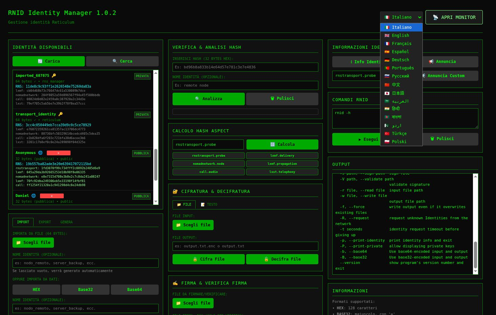
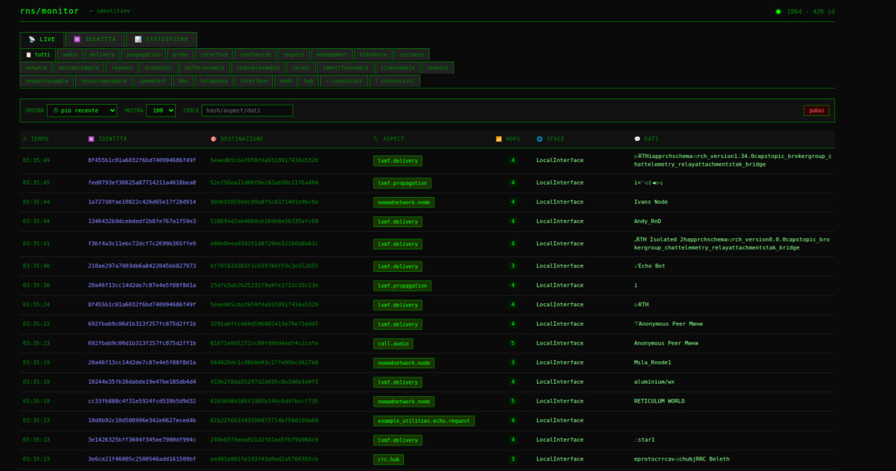
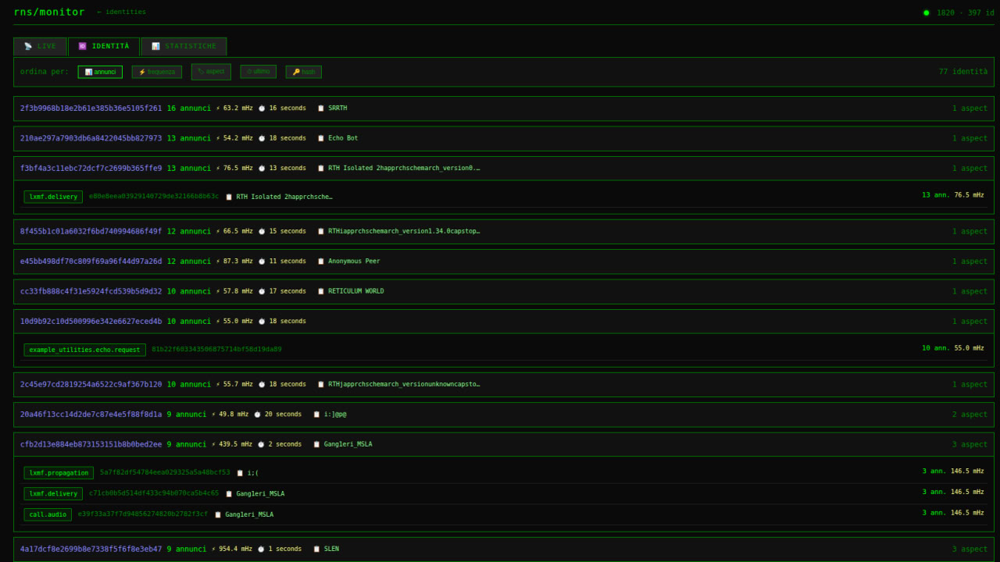
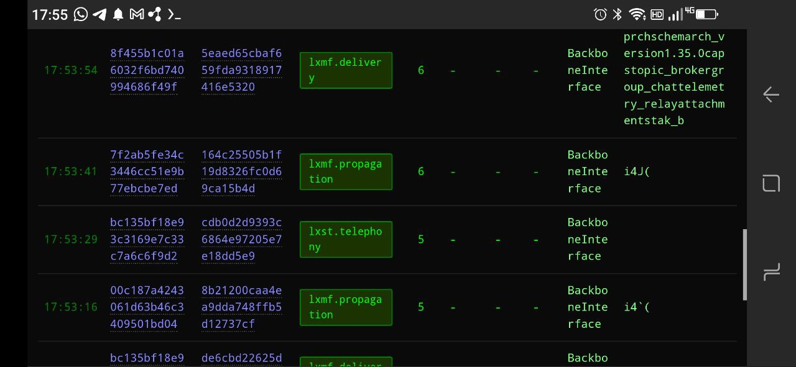
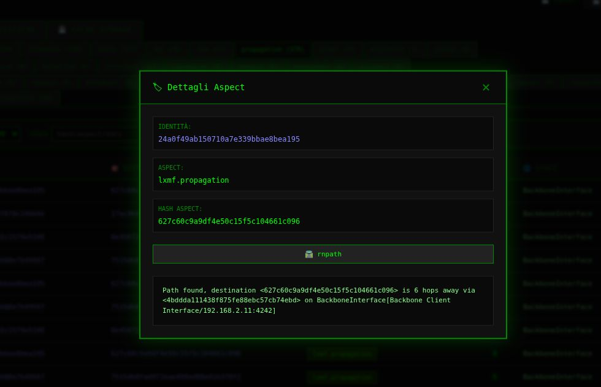
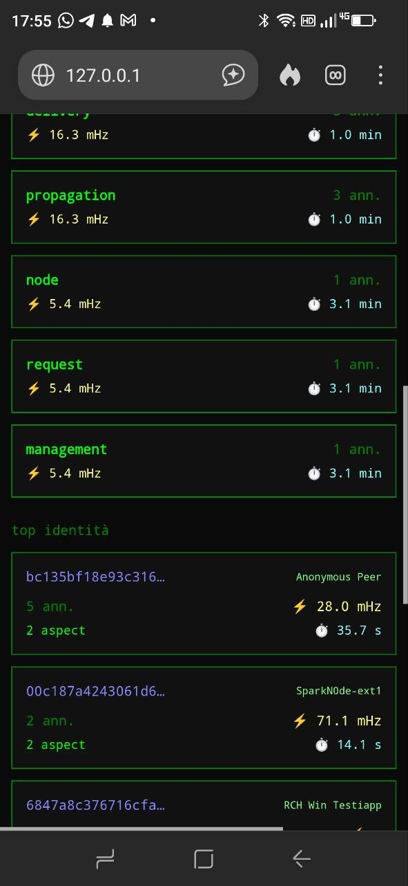
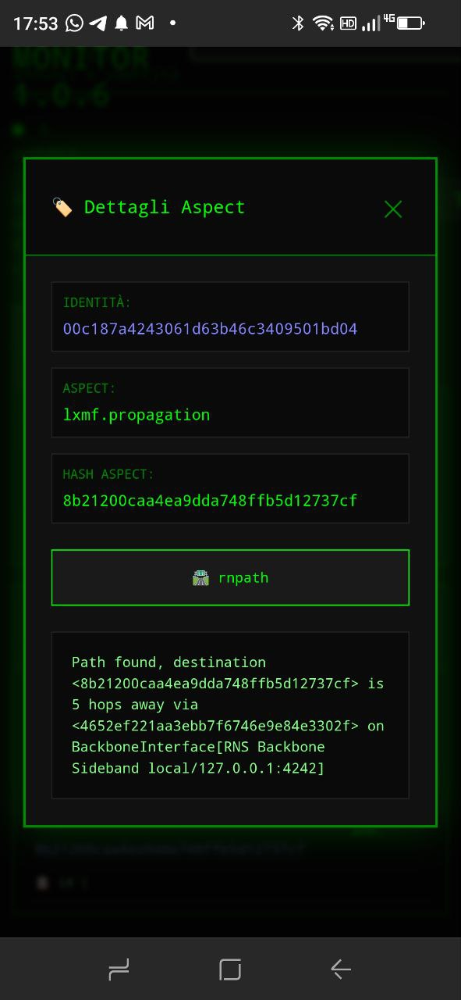
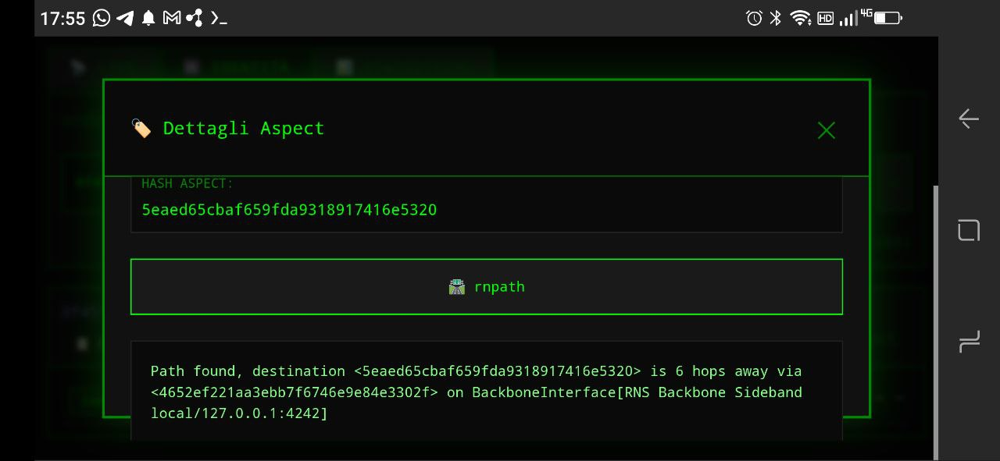

# 🔑 RNS Manager & Monitor 🌐

[English](README.md) | **Русский**

Веб-интерфейс для управления идентичностями Reticulum (RNS) и мониторинга сетевых анонсов в реальном времени.

Это проект **Manager**. Мессенджер LXMF — отдельный проект в [`../messenger/`](../messenger/).

## 📋 Обзор



Основные возможности:

- **Управление идентичностями RNS**: создание, импорт, экспорт, просмотр, шифрование/подпись
- **Мониторинг анонсов в реальном времени** с фильтрами, статистикой и постоянным кэшем
- **Команды RNS** (`rnstatus`, `rnpath`, `rnprobe`) через графический интерфейс
- **Шифрование/расшифровка** файлов и текста с идентичностями RNS
- **Цифровая подпись и проверка** (`.rsg`)
- **Интерфейс на 15 языках** (it, en, fr, es, de, pt, ru, zh, ja, ar, hi, bn, ur, tr, pl)

## ✨ Возможности

### Identity Manager
- ✅ Идентичности из `reticulum`, `nomadnetwork`, `lxmf`, `rnphone`, `meshchat`, `rns_manager`
- ✅ Импорт/экспорт в HEX, Base32, Base64 и бинарный файл
- ✅ Генерация новых идентичностей
- ✅ Анализ хэшей, расчёт хэша аспекта, проверка назначения
- ✅ Шифрование/расшифровка файлов и текста
- ✅ Цифровая подпись и проверка подписей

### Монитор аспектов
- 📡 Анонсы в реальном времени через **SSE** (`/api/monitor/stream`)
- 🔍 Фильтры по аспектам, текстовый поиск, сортировка
- 📊 Статистика по идентичностям/аспектам/интерфейсам и радиоданные (RSSI, SNR, Q)
- 🏷️ Автоматическое распознавание аспектов с кэшем по идентичностям
- 💾 Постоянный кэш SQLite (`cache/announces.db`, 7 дней, до 100 000 записей)
- 🖱️ Интерактивные модальные окна для `rnpath`, `rnprobe` и проверки blackhole



## 📸 Скриншоты

| Компьютер | Мобильный |
|---|---|
|  |  |
|  |  |
|  |  |

Другие изображения: `img/rnid-es.jpg` (испанский интерфейс), `img/rnid-ar.jpg` и `img/arab-RNID.jpg` (арабский), `img/rnid-ru.jpg` (русский), `img/monitor-mobile-header.jpg`, `img/monitor-mobile-identity-filter.jpg`, `img/monitor-ID.jpg`, `img/aspect.jpg`.

## 🚀 Установка

### Требования
- Python 3.8+
- Установленный и настроенный Reticulum
- Команды `rnid`, `rnstatus`, `rnpath`, `rnprobe` в `PATH`

### Запуск

```bash
git clone https://github.com/argo79/RNS-Manager.git
cd RNS-Manager/manager

pip install -r requirements.txt
python3 rns_manager.py
```

Или:

```bash
./start.sh
```

Затем откройте:

- Identity Manager: <http://127.0.0.1:5010/>
- Монитор аспектов: <http://127.0.0.1:5010/api/monitor> (`/monitor` перенаправляет сюда)

Браузер открывается автоматически при запуске.

## 📁 Структура проекта

```ini
manager/
├── rns_manager.py            # Основной Flask-сервер
├── version.py
├── requirements.txt
├── modules/
│   └── rns_monitor.py        # Монитор анонсов (процесс + SQLite + blueprint)
├── templates/
│   ├── index.html            # Identity Manager
│   └── monitor.html          # Монитор аспектов
├── static/                   # CSS, favicon, переводы
├── tools/                    # Диагностика аспектов и пример анонса
├── img/                      # Скриншоты
├── rns_manager.spec          # Спецификация PyInstaller
└── build_rns_manager.sh      # Сборка автономного исполняемого файла
```

Рабочие каталоги, создаваемые в `manager/`: `cache/`, `downloads/`, `tmp/` и `rns_monitor.sock`.

## 🗂️ Каталоги идентичностей

Идентичности ищутся в:

```ini
~/.reticulum/storage/
~/.nomadnetwork/storage/
~/.lxmf/storage/
~/.rnphone/
~/.reticulum-meshchat/
~/.rns_manager/storage/
```

`~/.rns_manager/storage/` **общий с Messenger**: импортированные здесь идентичности доступны обоим приложениям.

## 🎮 Использование

**Identity Manager**: нажмите *Загрузить*, чтобы получить список идентичностей, выберите нужную и используйте *Информация*, *Анонс*, *Импорт/Экспорт*, *Генерация*, *Шифрование/Расшифровка*, *Подпись/Проверка*.

**Монитор аспектов**: вкладки *Live*, *Идентичности* и *Статистика*; нажмите на хэш, чтобы открыть `rnpath`, `rnprobe`, `rnpath -p`.

## 🔧 Настройка

- **Кэш идентичностей**: 5 минут (в памяти); *Глубокий поиск* запускает полное сканирование.
- **Кэш анонсов**: SQLite в `cache/announces.db`, хранение 7 дней.
- **Распознаваемые аспекты**: список `RNS_ASPECTS` в `modules/rns_monitor.py` **и** массив `ASPECTS` в `templates/monitor.html` должны совпадать.
- **Каталоги поиска**: `USER_DIRECTORIES` в `rns_manager.py`.
- **Переводы интерфейса**: `static/index_translations.json` (15 языков); язык по умолчанию определяется браузером, переключатель находится в заголовке.

## 📊 Основные API

```ini
GET  /api/identities/list          POST /api/identities/import/file
POST /api/identities/import/data   POST /api/identities/export
POST /api/identities/generate      POST /api/identities/info
POST /api/identities/encrypt       POST /api/identities/decrypt
POST /api/identities/sign          POST /api/identities/verify
GET  /api/identities/find/by-hash  POST /api/rnid
GET  /api/monitor                  GET  /api/monitor/stats
GET  /api/monitor/history          GET  /api/monitor/stream
GET  /api/monitor/sqlite/stats     GET  /api/monitor/sqlite/search
POST /api/monitor/clear            POST /api/monitor/reset-all
POST /api/monitor/sqlite/cleanup   POST /api/monitor/sqlite/vacuum
GET  /api/rns/status               GET  /api/rns/paths
POST /api/rns/probe                POST /api/rns/probe/aspect
POST /api/rns/paths/blackhole      POST /api/shutdown
POST /api/files/relocate           # перемещение/копирование tmp -> downloads (без shell)
```

## 📦 Сборка автономного файла

```bash
cd manager
./build_rns_manager.sh
# результат: dist/rns_manager_v<версия>.run
```

## 📱 Android через Termux

```bash
git clone https://github.com/argo79/RNS-Manager.git
cd RNS-Manager/manager
pip install -r requirements.txt --break-system-packages
python3 rns_manager.py
```

Откройте `http://127.0.0.1:5010` в браузере.

## 🔗 Связанные проекты

- **RNS Messenger** ([`../messenger/`](../messenger/)): полноценный чат LXMF с вложениями, аудио, телеметрией и картой. Запускается отдельно на порту **5012**.

## 🐛 Известные проблемы

- Первое сканирование идентичностей может занять 10–30 секунд.
- Некоторые аспекты могут не распознаваться.
- На мобильных устройствах некоторые таблицы требуют горизонтальной прокрутки.

## 📝 Лицензия

Распространяется по лицензии MIT. См. [`../LICENSE`](../LICENSE).

## 📧 Контакты

- Email: <arg0netds@gmail.com>
- GitHub: <https://github.com/argo79/RNS-Manager>
- RNS Identity: `04511923b68ae34e0fda5721d82f596f`

