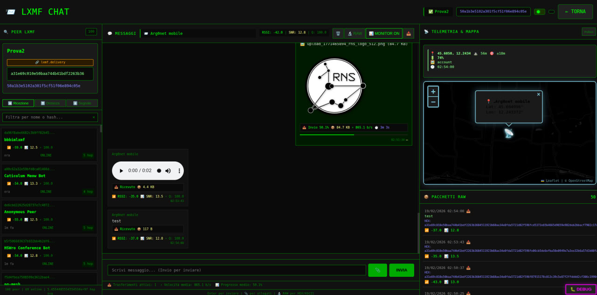

# 💬 RNS Messenger

Web messenger per **LXMF** (Lightweight Extensible Message Format) su Reticulum, con allegati, messaggi audio, telemetria, mappa e comandi remoti.

Progetto separato dal [Manager](../manager/): condivide con esso solo la cartella dati `~/.rns_manager/` (identità, configurazione, upload).



## ✨ Caratteristiche

- 💬 Chat uno-a-uno su LXMF con cronologia conversazioni persistente
- 👥 Peer con gruppi/trust (preferiti, casa, lavoro, famiglia, amici, server, bot, monitoraggio, ricerca, pubblico)
- 📎 Allegati: file, immagini e audio
- 🎙️ Registrazione audio Opus nel browser e supporto **Codec2** (450–3200 bps) via `pycodec2`
- 📊 Telemetria: sistema, batteria, pressione, temperatura, umidità, campo magnetico, posizione, link fisico
- 🗺️ Mappa Leaflet con posizione dei peer e storico telemetria
- 🎮 Comandi remoti LXMF: telemetria, ping, echo, signal report, rangetest
- 📡 Nodi di propagazione: configurazione e sincronizzazione messaggi
- 📣 Invio announce e import peer dalla cache del monitor
- ⚡ Aggiornamenti in tempo reale via **Socket.IO** (progressi di invio, messaggi in arrivo)
- 🗃️ Archivio messaggi raw consultabile e scaricabile

## 🚀 Installazione

### Prerequisiti
- Python 3.9+
- Reticulum (`rns`), `lxmf`, `lxst`
- Un'identità RNS esistente (creata/importata con il Manager in `~/.rns_manager/storage/`)

### Dipendenze

```bash
cd RNS-Manager/messenger
pip install -r requirements.txt
```

Opzionali:
- `ffmpeg` nel `PATH` per la conversione audio OGG/Opus
- `pycodec2` + libcodec2 per i messaggi Codec2
- `gps` / `gpsd` per la telemetria di posizione da GPSD

### Avvio

```bash
./start.sh
# oppure
python3 lxmf_chat.py -p 5012
```

Con un'identità specifica:

```bash
python3 lxmf_chat.py -i ~/.rns_manager/storage/<nome_identita> -p 5012
```

Poi aprire <http://127.0.0.1:5012/> (alias: `/chat`).

> Il server ascolta su `127.0.0.1` per impostazione predefinita.
> Per esporlo in LAN: `python3 lxmf_chat.py --host 0.0.0.0 -p 5012`.

## 📁 Struttura

```ini
messenger/
├── lxmf_chat.py          # Web server Flask + Socket.IO (entry point)
├── messenger.py          # Core LXMF: identità, invio/ricezione, telemetria, comandi
├── audio_codec.py        # Codec2 / Opus (pycodec2 + LXST)
├── telemetry_provider.py # Sensori di sistema e posizione
├── core/
│   └── telemeter.py      # Campi FIELD_TELEMETRY (sensori LXMF)
├── templates/
│   └── lxmf_chat.html    # Interfaccia web
├── static/               # CSS, favicon, encoder Opus/WASM
├── version.py
├── requirements.txt
├── rns_messenger.spec    # Spec PyInstaller
└── build_rns_messenger.sh
```

## 🗂️ Dati condivisi con il Manager

```ini
~/.rns_manager/storage/          # identità e database peers/conversazioni
~/.rns_manager/config.json       # configurazione (propagation node, GPSD, ecc.)
~/.rns_manager/uploads/          # file caricati
~/.rns_manager/Cache/announces.db
```

Le identità importate dal Manager sono selezionabili nel messenger e viceversa.

## 🎮 Utilizzo

1. Seleziona un'identità dalla lista (o avvia con `-i`).
2. Scegli un peer e invia testo, file, immagini o audio.
3. Apri il pannello telemetria per richiedere i dati o seguirli sulla mappa.
4. Usa il pannello comandi per ping/echo/signal report/rangetest.
5. Configura un nodo di propagazione se i peer non sono raggiungibili direttamente.

## 📊 API principali

```ini
GET  /                            GET  /chat
GET  /api/status                  GET  /api/identities
POST /api/identity/select         GET  /api/peers
GET  /api/conversation/<hash>     POST /api/send
POST /api/command                 POST /api/telemetry/request
GET  /api/telemetry/config        POST /api/telemetry/config
GET  /api/telemetry/history/<h>   POST /api/telemetry/test
GET  /api/peer/<hash>/telemetry/last
GET  /api/raw/history             GET  /api/raw/history/<hash>
GET  /api/raw/<hash>              GET  /download/<filename>
GET  /api/config                  POST /api/config
POST /api/sync                    POST /api/announce
POST /api/peers/import            POST /api/cleanup_temp
GET  /api/attachment/<hash>       POST /api/shutdown
GET  /api/favorites               POST /api/favorites/add
POST /api/favorites/remove        POST /api/peer/update
```

Eventi Socket.IO: `connect`, `disconnect`, `ping_server` (client → server); `progress_update`, `message`, `identity_loaded` (server → client).

## 📦 Build eseguibile

```bash
cd messenger
./build_rns_messenger.sh
# output: dist/rns_messenger_v<versione>.run
```

## 🔧 Troubleshooting

- **`No module named 'flask_socketio'`** → `pip install -r requirements.txt`
- **`No module named 'gpsdclient'`** → `pip install gpsdclient`
- **Nessuna identità disponibile** → importa/crea un'identità con il [Manager](../manager/) o copiala in `~/.rns_manager/storage/`
- **Audio non convertito** → installa `ffmpeg`; per Codec2 serve `pycodec2` con libcodec2
- **Mappa vuota** → richiedi la telemetria a un peer che espone la posizione

## 🔗 Progetti correlati

- **RNS Manager & Monitor** ([`../manager/`](../manager/)): gestione identità e monitor annunci su porta **5010**.

## 📝 Licenza

Distribuito sotto licenza MIT. Vedi [`../LICENSE`](../LICENSE).

## 📧 Contatto

- Email: <arg0netds@gmail.com>
- GitHub: <https://github.com/argo79/RNS-Manager>
- RNS Identity: `04511923b68ae34e0fda5721d82f596f`

English version: [README.en.md](README.en.md)

