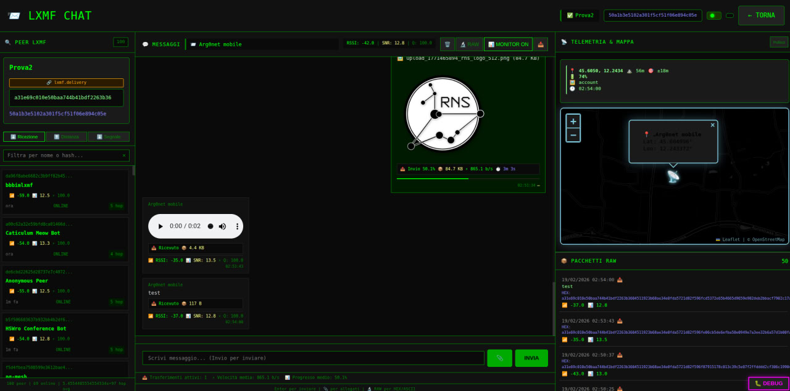

# 💬 RNS Messenger

[English](README.md) | **Русский**

Веб-мессенджер для **LXMF** (Lightweight Extensible Message Format) поверх Reticulum, с вложениями, голосовыми сообщениями, телеметрией, картой и удалёнными командами.

Это отдельный проект от [Manager](../manager/README.ru.md): единственный общий ресурс — каталог данных `~/.rns_manager/` (идентичности, конфигурация, загрузки).



## ✨ Возможности

- 💬 Личные чаты LXMF с сохраняемой историей переписки
- 👥 Пиры с несколькими группами/доверием (избранное, дом, работа, семья, друзья, сервер, бот, мониторинг, исследование, публичный; новый пир создаётся без группы)
- 📢 Кнопка ручного объявления идентичности в заголовке
- 📎 Вложения: файлы, изображения и аудио
- 🎙️ Запись в браузере и воспроизведение **Codec2 1200/3200** (декодирование в WAV на сервере) и **Opus** (Ogg/WebM)
- 📊 Телеметрия: система, батарея, давление, температура, влажность, магнитное поле, местоположение, физическое соединение
- 🛰️ Диагностика запросов телеметрии и глобальные разрешения запросов/команд
- 📇 Компактные раскрывающиеся контакты и подробные HEX/ASCII пакеты по клику
- 🗺️ Карта Leaflet с позициями пиров и историей телеметрии
- 🎮 Удалённые команды LXMF: телеметрия, ping, echo, signal report, rangetest
- 📡 Узлы распространения: настройка и синхронизация сообщений
- 📣 Отправка анонсов и импорт пиров из кэша монитора
- ⚡ Обновления в реальном времени через **Socket.IO** (прогресс отправки, входящие сообщения)
- 🗃️ Просмотр и скачивание архива исходных сообщений

## 🚀 Установка

### Требования
- Python 3.9+
- Reticulum (`rns`), `lxmf`, `lxst`
- Существующая идентичность RNS (созданная/импортированная в Manager в `~/.rns_manager/storage/`)

### Зависимости

```bash
cd RNS-Manager/messenger
pip install -r requirements.txt
```

Дополнительно:
- `ffmpeg` в `PATH` для конвертации аудио OGG/Opus
- `pycodec2` + libcodec2 для сообщений Codec2
- `gps` / `gpsd` для телеметрии местоположения из GPSD

### Запуск

```bash
./start.sh
# или
python3 lxmf_chat.py -p 5012
```

С определённой идентичностью:

```bash
python3 lxmf_chat.py -i ~/.rns_manager/storage/<имя_идентичности> -p 5012
```

Затем откройте <http://127.0.0.1:5012/> (алиас: `/chat`).

> По умолчанию сервер слушает `127.0.0.1`.
> Чтобы открыть доступ в локальной сети: `python3 lxmf_chat.py --host 0.0.0.0 -p 5012`
> (не рекомендуется: у веб-интерфейса нет аутентификации).

## 🔐 Безопасность

- Веб-сервер по умолчанию слушает localhost; запросы с нелокальным заголовком `Host` или
  межсайтовым `Origin`/`Referer` для методов, изменяющих состояние, отклоняются
  (защита от DNS-rebinding/CSRF).
- Включены заголовки безопасности (`CSP`, `X-Frame-Options`, `X-Content-Type-Options`).
- **Не открывайте UI в локальной сети/Интернете без аутентификации и TLS**: любой, кто может
  подключиться к порту, получит доступ к загруженной идентичности.
- Удалённые LXMF-команды (`ping`, `echo`, `signal`, запросы телеметрии, `rangetest`) **запрещены по умолчанию**.
  Разрешайте их для пира через `allow_commands` / `allow_telemetry` в `destinations` или глобально через
  `allow_remote_commands` / `allow_telemetry_requests` в `~/.rns_manager/config.json`.
- Загрузки ограничены 64 МБ, имена файлов очищаются. Изображения отдаются только для
  разрешённых форматов (`jpg`, `png`, `gif`, `webp`); остальное — вложение.
- Необязательная токен-аутентификация: задайте `LXMF_AUTH_TOKEN` и откройте UI с `?token=...`
  (поддерживаются cookie и заголовок).
- `RNS_DEBUG_PACKETS=1` включает полный hex/ASCII-дамп пакетов (очень подробно).
- Хранение данных (`config.json`, `0` отключает): `message_retention_days` (по умолчанию 90),
  `raw_retention_days` (30), `telemetry_retention_days` (90), `rangetest_retention_days` (90).
- Leaflet, Socket.IO и MDI загружаются с закреплённых CDN: браузеру нужен интернет
  для карты/иконок/realtime (серверная часть работает офлайн).

## 📁 Структура

```ini
messenger/
├── lxmf_chat.py          # Веб-сервер Flask + Socket.IO (точка входа)
├── messenger.py          # Ядро LXMF: идентичность, отправка/приём, телеметрия, команды
├── audio_codec.py        # Codec2 / Opus (pycodec2 + LXST)
├── telemetry_provider.py # Системные датчики и геолокация
├── core/
│   └── telemeter.py      # Поля FIELD_TELEMETRY (датчики LXMF)
├── templates/
│   └── lxmf_chat.html    # Веб-интерфейс
├── static/               # CSS, favicon, vendor/ (Leaflet, Socket.IO)
├── version.py
├── requirements.txt
├── rns_messenger.spec    # Спецификация PyInstaller
└── build_rns_messenger.sh
```

## 🗂️ Данные, общие с Manager

```ini
~/.rns_manager/storage/          # идентичности и базы пиров/переписок
~/.rns_manager/config.json       # конфигурация (узел распространения, GPSD и т.д.)
~/.rns_manager/uploads/          # загруженные файлы
~/.rns_manager/cache/announces.db
```

Идентичности, импортированные через Manager, доступны в мессенджере, и наоборот.

## 🎮 Использование

1. Выберите идентичность из списка (или запустите с `-i`).
2. Выберите пира и отправьте текст, файлы, изображения или аудио.
3. Откройте панель телеметрии, чтобы запросить данные или отслеживать их на карте.
4. Используйте панель команд для ping/echo/signal report/rangetest.
5. Настройте узел распространения, если пиры недоступны напрямую.
6. Фильтруйте список пиров по aspect анонсов. По умолчанию: `lxmf.delivery`, `lxmf.propagation`, `rnstransport.discovery.interface`; другие можно добавить во вкладке **CONFIG** или через `announce_aspects` / `LXMF_ANNOUNCE_ASPECTS=a,b`.
7. В режиме `lxmf.propagation` список показывает узлы propagation с действиями установки/замены текущего узла. Карта открывается для любого aspect; в delivery она показывает контакты с известными координатами вместе с интерфейсами discovery, маркеры фильтруются по контактам/типам интерфейсов.
8. В режиме `rnstransport.discovery.interface` карта автоматически занимает центральную область; маркеры интерфейсов показывают имя и число хопов, тип выражается цветом/иконкой.
9. Identity hash и delivery hash отображаются полностью в списке контактов и копируются по клику.
10. Карта использует бесплатные провайдеры без API-ключей (Esri World Street/Topographic/Imagery, OpenStreetMap, OpenTopoMap, CyclOSM), а Leaflet/Socket.IO загружаются локально из `static/vendor/`. Видимый селектор слоёв меняет провайдера без изменения текущего центра/зума. **Карта никогда не следует за новыми анонсами:** вид меняют только пользовательский pan/zoom и явные действия 🎯 «показать маркеры» и 📍 «центрировать на мне».
11. Инструменты карты: расстояние (📏), площадь круга (⭕) и площадь прямоугольника (▭). Значения и предпросмотр обновляются в реальном времени при движении мыши. Измерения находятся на отдельном слое и не исчезают при обновлении анонсов; 🧹 очищает их.
12. Анонсы `rnstransport.discovery.interface` разбираются безопасно: интерфейс показывает тип/имя, host/port и координаты, но никогда не IFAC-ключи или сгенерированные записи конфигурации. Автоподключение к найденным интерфейсам не выполняется.
13. Узел propagation настраивается или удаляется в **CONFIG → NODO PROPAGATION** кнопками **IMPOSTA** / 🗑️. Настройка применяется сразу и сохраняется в `config.json`; при замене уже заданного узла запрашивается подтверждение.

### Публикация interface discovery

Для **получения** анонсов discovery настраивать Reticulum не нужно: Messenger сам регистрирует aspect и запрашивает его у shared instance. Чтобы сделать свой интерфейс видимым, настройте его на анонсирующем узле:

```ini
[[My RNode]]
  type = RNodeInterface
  interface_enabled = yes
  # ... параметры интерфейса ...
  discoverable = yes
  discovery_name = My node
  latitude = 45.4642
  longitude = 9.1900
  height = 120
  # Необязательно: команда, печатающая "lat,lon,alt"
  # location_cmd = /usr/local/bin/gps-location
```

Discovery поддерживают `BackboneInterface`, `TCPServerInterface`, `TCPClientInterface`, `RNodeInterface`, `WeaveInterface`, `I2PInterface` и `KISSInterface`. Координаты публичны и показываются только при наличии в анонсе. Не включайте `discovery_encrypt` без network identity у получателей и не используйте `publish_ifac` без необходимости.


## 📊 Основные API

```ini
GET  /                            GET  /chat
GET  /api/status                  GET  /api/identities
GET  /api/aspects                 GET  /api/peers?aspect=<aspect>
GET  /api/map/peers
POST /api/identity/select         POST /api/exit
GET  /api/conversation/<hash>     POST /api/send
POST /api/command                 POST /api/telemetry/request
GET  /api/telemetry/config        POST /api/telemetry/config
GET  /api/telemetry/history/<h>   POST /api/telemetry/test
GET  /api/peer/<hash>/telemetry/last
GET  /api/raw/history             GET  /api/raw/history/<hash>
GET  /api/raw/<hash>
GET  /api/config                  POST /api/config
POST /api/propagation
POST /api/sync                    POST /api/announce
POST /api/peers/import            POST /api/cleanup_temp
GET  /api/attachment/<hash>       POST /api/shutdown
GET  /api/favorites               POST /api/favorites/add
POST /api/favorites/remove        POST /api/peer/update
POST /api/peer/<hash>/favorite    POST /api/peer/<hash>/groups
POST /api/groups/reset
GET  /api/announce/stats
GET  /api/telemetry/stats
```

События Socket.IO: `connect`, `disconnect`, `ping_server` (клиент → сервер); `connected`, `pong`, `peer_update`, `progress_update`, `new_message`, `delivery_update`, `sync_complete`, `identity_loaded` (сервер → клиент).

## 📦 Сборка автономного файла

```bash
cd RNS-Manager
python3.11 -m venv .venv
source .venv/bin/activate
python -m pip install -r messenger/requirements.txt pyinstaller

cd messenger
./build_rns_messenger.sh
# результат: ../dist/rns_messenger_v<версия>.run
```

Сборка выполняется в чистом virtualenv и включает `RNS`, `LXMF`, `LXST`, `numpy`
и `pycodec2` (с встроенной `libcodec2`). Messenger использует конфигурацию
`~/.reticulum` пользователя. Ожидаемый размер — примерно 35-45 МБ.
Файлы `.run` публикуйте в GitHub **Release** (лимит 2 ГБ на файл), а не в
репозитории (лимит 100 МБ на файл).

## 🔧 Устранение неполадок

- **`No module named 'flask_socketio'`** → `pip install -r requirements.txt`
- **`No module named 'gpsdclient'`** → `pip install gpsdclient`
- **Нет доступных идентичностей** → импортируйте/создайте идентичность в [Manager](../manager/README.ru.md) или скопируйте её в `~/.rns_manager/storage/`
- **Аудио не конвертируется** → установите `ffmpeg`; для Codec2 установите `pycodec2` с libcodec2
- **Карта пуста** → запросите телеметрию у пира, который передаёт местоположение

## 🔗 Связанные проекты

- **RNS Manager & Monitor** ([`../manager/`](../manager/)): управление идентичностями и монитор анонсов на порту **5010**.

## 📝 Лицензия

Распространяется по лицензии MIT. См. [`../LICENSE`](../LICENSE).

## 📧 Контакты

- Email: <arg0netds@gmail.com>
- GitHub: <https://github.com/argo79/RNS-Manager>
- RNS Identity: `04511923b68ae34e0fda5721d82f596f`

